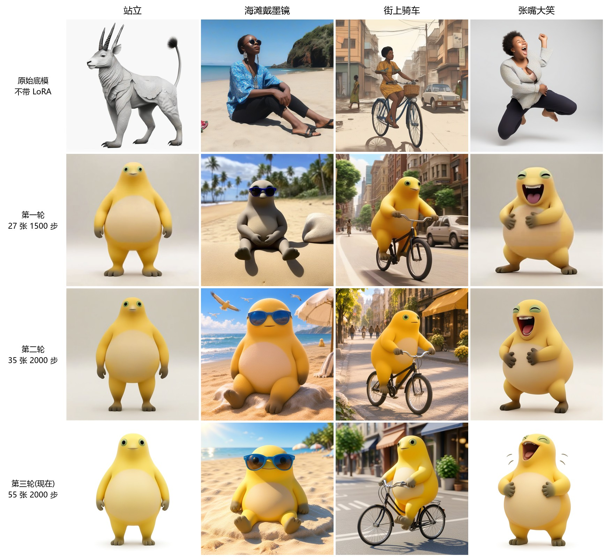

# dennis-model

我训练的模型合集。每个模型放在 `models/` 下的独立文件夹里,用法和训练记录写在各自的 README 中。

## 模型列表

| 模型 | 类型 | 底模 | 触发词 | 说明 |
|---|---|---|---|---|
| [奶蛙 naiwa](models/naiwa/) | 图像 LoRA | SDXL 1.0 | `naiwa` | 黄色、丑萌风格的奶蛙角色,可换动作和场景 |



## 目录结构

```text
dennis-model/
├── README.md                  # 模型列表
└── models/
    └── naiwa/                 # 每个模型一个文件夹
        ├── README.md          # 这个模型的用法和训练记录
        ├── *.safetensors      # 模型文件
        └── images/            # 这个模型的效果图
```

## 下载

模型文件用 Git LFS 存储,克隆前先安装 LFS。

```bash
git lfs install
git clone https://github.com/Dennisyu-m/dennis-model.git
```

只想要某一个模型时,可以跳过大文件,再单独拉取:

```bash
GIT_LFS_SKIP_SMUDGE=1 git clone https://github.com/Dennisyu-m/dennis-model.git
```

```bash
cd dennis-model
git lfs pull --include="models/naiwa/*"
```
