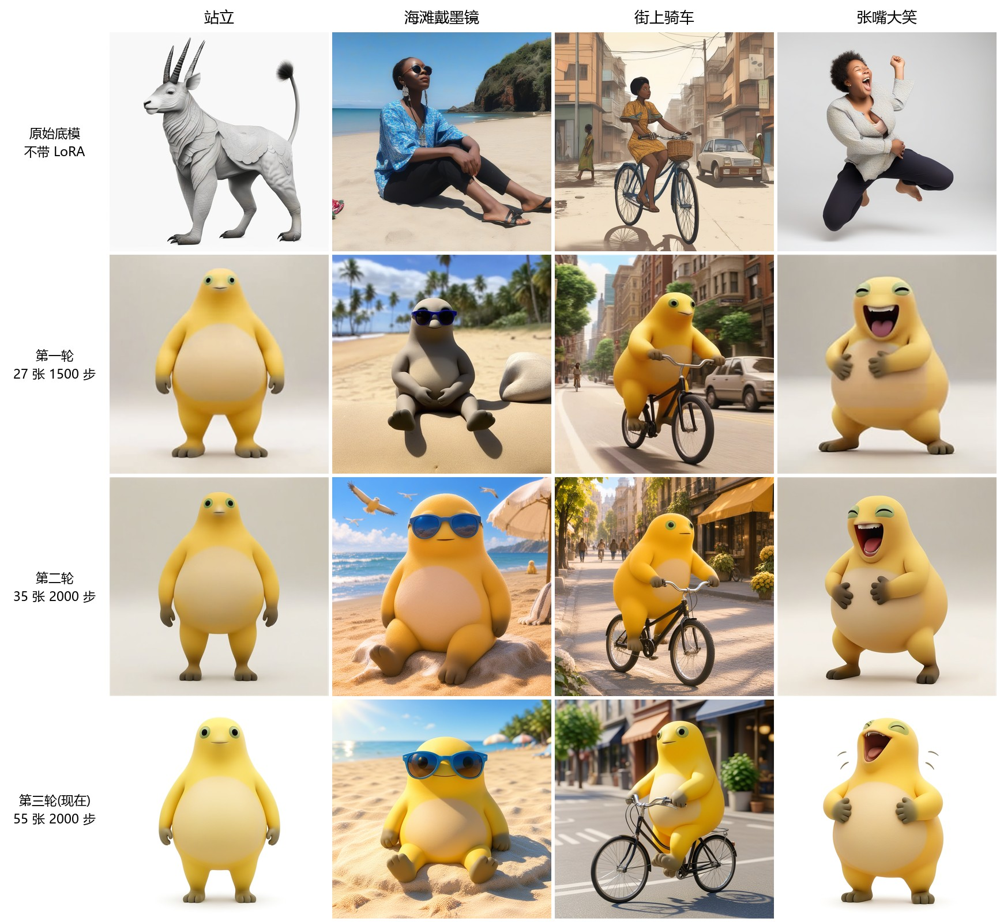
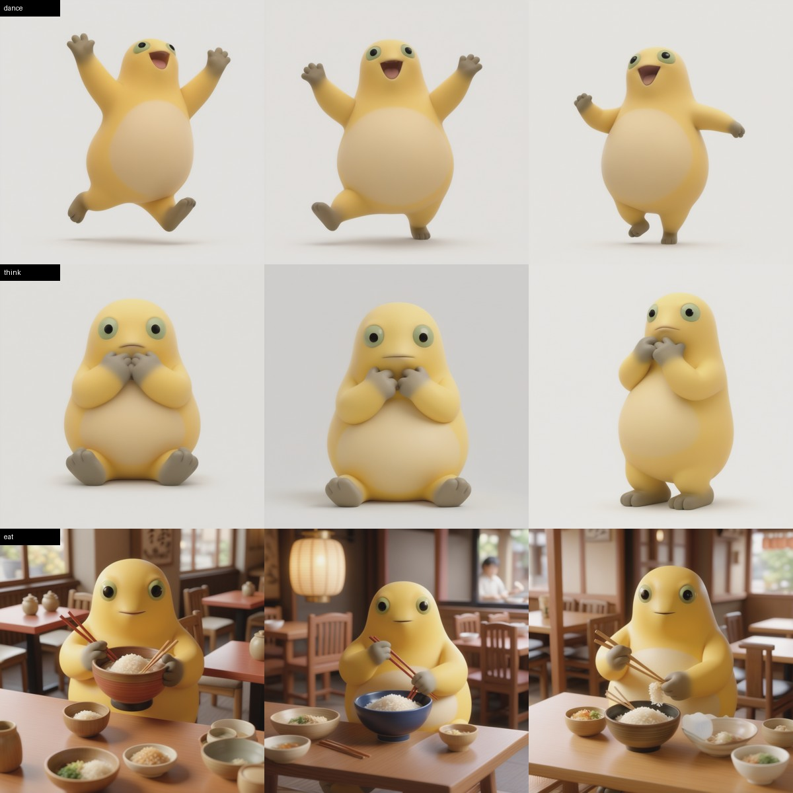
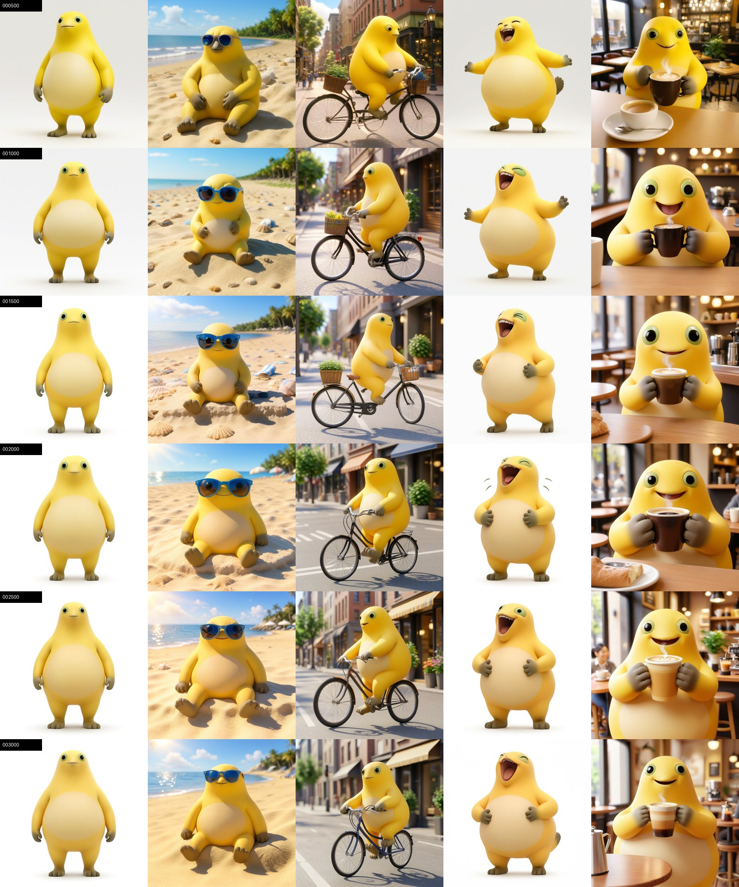

# 奶蛙 naiwa

奶蛙 LoRA:一个基于 SDXL 1.0 的图像模型,用来画黄色、丑萌风格的"奶蛙"角色。

提示词里加上触发词 `naiwa`,就能让奶蛙换动作、换场景。



## 文件

| 文件 | 说明 |
|---|---|
| `naiwa_v3-step00002000.safetensors` | 模型本体,约 114MB,用 Git LFS 存储 |
| `images/compare_all_rounds.jpg` | 原始底模和三轮模型的对比 |
| `images/compare_round3.jpg` | 第三轮 500–3000 步的对比 |
| `images/test_dance_think_eat.jpg` | 跳舞、思考、吃饭的实测图 |

仓库不包含训练图片。

## 下载

模型用 Git LFS 存储,克隆前先安装 LFS:

```bash
git lfs install
git clone https://github.com/Dennisyu-m/dennis-model.git
```

## 使用

需要两样东西:

- 底模:[Stable Diffusion XL Base 1.0](https://huggingface.co/stabilityai/stable-diffusion-xl-base-1.0)
- VAE(推荐):[sdxl-vae-fp16-fix](https://huggingface.co/madebyollin/sdxl-vae-fp16-fix)

用 diffusers 出图:

```python
import torch
from diffusers import StableDiffusionXLPipeline, EulerAncestralDiscreteScheduler

pipe = StableDiffusionXLPipeline.from_single_file(
    "sd_xl_base_1.0.safetensors", use_safetensors=True
)
pipe.scheduler = EulerAncestralDiscreteScheduler.from_config(pipe.scheduler.config)
pipe.to("cuda")
pipe.load_lora_weights("models/naiwa", weight_name="naiwa_v3-step00002000.safetensors")

image = pipe(
    "naiwa, dancing happily, arms raised, one leg lifted, white background",
    negative_prompt="lowres, blurry, text, watermark, deformed",
    width=1024,
    height=1024,
    num_inference_steps=30,
    guidance_scale=7,
).images[0]
image.save("naiwa.png")
```

提示词写法:以 `naiwa` 开头,后面写动作、表情、道具和背景。

## 效果



从上到下依次是跳舞、思考、吃饭,每行 3 个不同种子。

- 跳舞效果最好。
- 吃饭的碗筷和场景正确,但角色只是端碗拿筷子,没有吃进嘴里,筷子拿法也不太对。
- "手托下巴"这类细动作不够准,会画成双手放在嘴前。
- 全身远景时眼睛偏小,近景正常。
- 上面这张测试图用 diffusers 生成,颜色比下面的 kohya 训练样图淡,原因还没有确认。

## 训练过程

| 轮次 | 数据 | 总步数 | 结果 |
|---|---|---|---|
| 第一轮 | 27 张 | 2000 | 学会了形象,但换场景时身体变灰 |
| 第二轮 | 35 张 | 2500 | 海滩变成黄色,但画面清晰度不稳定 |
| 第三轮 | 55 张全高清 | 3000 | 画面清楚,颜色干净,手部动作基本正常 |

第三轮去掉了放大的低清缩略图,补充了近景和手部动作图。发布的是其中 2000 步的版本。



## 训练参数

| 参数 | 值 |
|---|---|
| 底模 | SDXL 1.0 |
| 训练工具 | kohya sd-scripts(commit cb70b96) |
| 硬件 | Colab A100 40GB,约 1.72 秒/步 |
| 分辨率 | 1024,分桶 512–1536 |
| LoRA | rank 16,alpha 8 |
| 学习率 | U-Net 1e-4,文本编码器 5e-5 |
| 优化器 | AdamW8bit,constant_with_warmup(100 步) |
| 其他 | min_snr_gamma 5,fp16,repeats 10,seed 42 |
